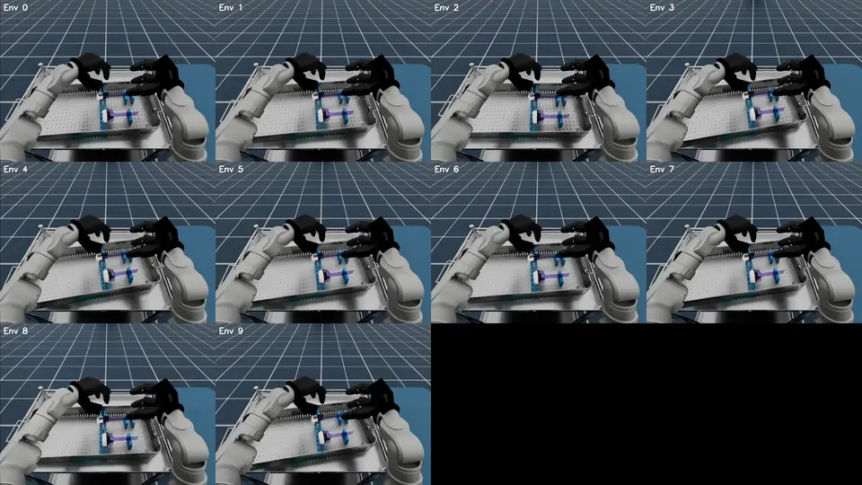
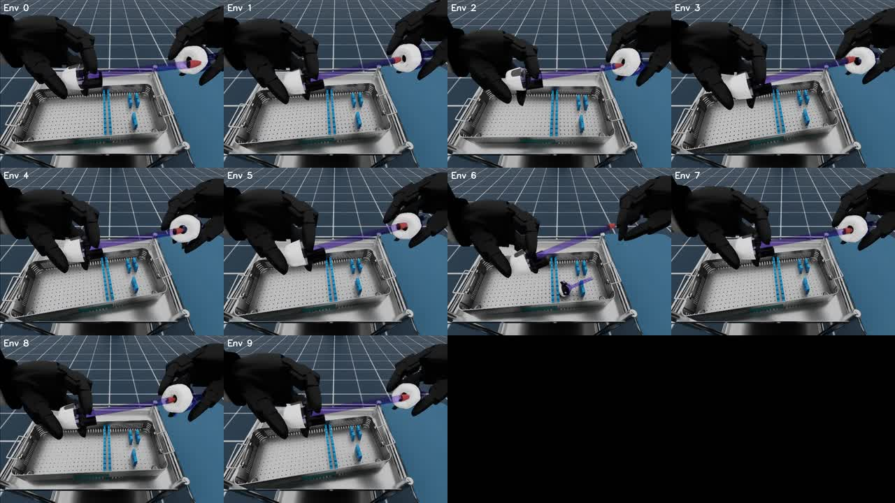
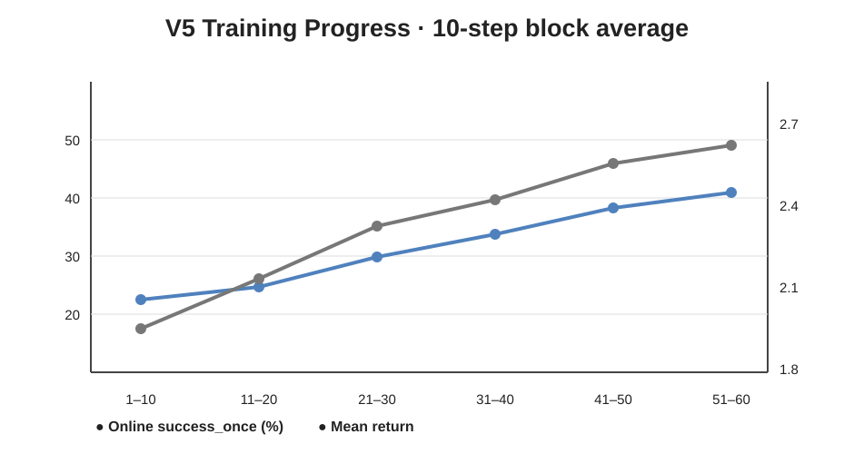
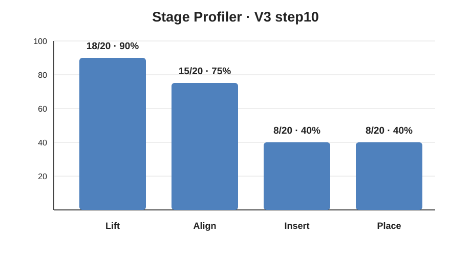

# G1 + Dex3 VLA RL Post-Training

基于 **Unitree G1 29-DOF + Dex3 双灵巧手**，在 Isaac Sim / Isaac Lab 中完成 Assemble Trocar 精细装配任务的 **GR00T-N1.5 + PPO Full-Parameter RL Post-Training**。

核心工作包括：从 clean SFT checkpoint 开始进行 **60 次 PPO update**，累计 **7,680 trajectories / ≈1.97M environment steps**；使用 **2× RTX PRO 6000 Blackwell + FSDP full_shard** 完成全参数训练；加入 Stage Profiler 定位阶段瓶颈，并对并行环境、host RAM、PPO 更新强度和失败视频进行系统分析。

| 项目 | 配置 |
|---|---|
| Robot | Unitree G1 29-DOF + Dex3 |
| Task | Assemble Trocar |
| VLA | GR00T-N1.5 |
| RL | RLinf PPO |
| Simulator | Isaac Sim 5.1 + IsaacLab + IsaacLab-Arena |
| Fine-tuning | Full-Parameter |
| Training | 60 PPO updates / 7,680 trajectories / ≈1.97M env steps |
| Compute | 2× RTX PRO 6000 Blackwell |

---

## Demo

展示双臂完成 **抓取 → 对准 → 插入 → 放置** 的完整过程。该 10-env Demo 中 **8/10 完成任务，成功率 80%**。

  

---

## 任务与控制接口

  

任务指令：

~~~text
install trocar from box
~~~

Rheo v0.5.0 将任务拆成四个阶段：

| Stage | 任务 |
|---|---|
| 1 | Lift |
| 2 | Align |
| 3 | Insert |
| 4 | Place |

策略输入为 front + left wrist + right wrist 三路图像和 28D robot state，输出 28D policy action；场景侧使用 43D action interface，通过 adapter 补齐前 15 维。评测沿用 Rheo v0.5.0 的 Stage4 success 定义。

这个任务的难点不在单纯抓取，而在双手接触后的精细对准与插入。后面的 Stage Profiler 和视频复核都指向同一个现象：策略通常能够完成 Lift 和大部分 Align，真正大量丢失成功率的是 **Align → Insert**。

运行环境与任务合同见 [`docs/runtime.md`](docs/runtime.md)。

---

## PPO Post-Training

最终训练从 clean SFT checkpoint 直接进行 Stage4 full-task PPO。

| 参数 | 配置 |
|---|---|
| Train env | 16 |
| Rollout / episode length | 256 |
| Rollout epochs | 8 |
| Update epochs | 4 |
| Micro / global batch | 64 / 1024 |
| Actor LR | 5e-6 |
| Value LR | 1e-4 |
| Gamma / GAE lambda | 0.99 / 0.95 |
| PPO clip | 0.2 |
| Precision | bf16 |
| Fine-tuning | Full-Parameter |
| FSDP | full_shard |
| Global steps | 60 |

每个 global step 采集 128 条 trajectory，完整训练共 **7,680 trajectories**；按 rollout length 256 计算约 **1.97M environment steps**。训练耗时 **43h27m**。

  

按 10-step block 统计，online `success_once` 从前 10 步的 22.42% 提升到最后 10 步的 40.78%，mean return 从 1.960 提升到 2.634。训练后期 KL / clip fraction 维持在较小范围，更新整体保持稳定，没有出现明显 PPO collapse。

详细配置见 [`configs/v5_final.yaml`](configs/v5_final.yaml) 和 [`docs/training.md`](docs/training.md)。

---

## 训练路线：V1 → V5

训练不是一次参数设置直接跑到最后，而是围绕 **更新强度、资源上限和阶段瓶颈** 逐步收敛到最终路线。

| 版本 | 主要调整 | 结果 |
|---|---|---|
| V1 | 8 env，micro2/global4，10 updates | 跑通 Full-FT PPO；critic 早期出现 EV NaN warning |
| V2 | 尝试 24 env，后改 16 env / global1024 / actor LR 5e-6 | 24 env 因 host RAM OOM 失败；16 env 稳定，但 actor 更新偏保守 |
| V3 | global512 / actor LR 1e-5 | PPO 更新更明显，但 online success 波动大，转向 Stage Profiler 做阶段诊断 |
| V4 | progressive sparse stage curriculum | 验证了 stage handoff 路线，但没有作为最终主线 |
| V5 | clean SFT → direct Stage4 full-task PPO | 最终路线，60/60 updates 完成 |

V3 之后没有继续只靠调 LR 推高整体 success，而是先回答“究竟卡在哪个阶段”。V4 一度尝试 progressive stage curriculum，但最终回到更直接、可解释的 V5：**从 clean SFT 直接做 Stage4 full-task PPO**，避免把自定义 stage handoff 混进最终结果。

完整版本演进见 [`docs/training_evolution.md`](docs/training_evolution.md)。

---

## Stage Profiler

整体 success 只能说明最终是否完成任务，Stage Profiler 用来继续追踪失败发生在哪个阶段。

  

| Stage | 累计通过 | 条件通过率 |
|---|---:|---:|
| Lift | 18/20（90%） | — |
| Align | 15/20（75%） | 15/18（83.3%） |
| Insert | 8/20（40%） | 8/15（53.3%） |
| Place | 8/20（40%） | 8/8（100%） |

主要损失出现在 **Align → Insert**：完成 Align 的 15 条轨迹中只有 8 条进入 Insert；完成 Insert 后 8/8 通过 Place。

Profiler 本身也经历了一次统计排错。最初只用 `(seed, env_id)` 作为轨迹 ID，会把不同 EnvWorker 内相同的 local env 合并。最终改为 `(seed, EnvWorker PID, local env_id)` 后重新统计，得到上面的真实阶段结果。这个修正不需要重跑 rollout，只需要重新解析已有日志。

详细记录见 [`docs/stage_profiler.md`](docs/stage_profiler.md)。

---

## Failure Analysis

结合 Stage Profiler 和评测视频，失败主要分为三类：

| 类型 | 表现 |
|---|---|
| Grasp / Retention | 零件滑脱、掉落后无法恢复稳定双手控制 |
| Fine Alignment / Insertion | 已完成粗对准，但长时间停在近同轴接触状态，无法满足插入条件 |
| Late-stage Place / Release | 已完成或接近插入，但最终 placement / release 条件未满足 |

最常见的是 **Fine Alignment / Insertion stall**。在典型失败里，双手已经把两部分送到接近同轴的位置，但会在最后几毫米的接触、姿态或插入深度上停住；另一类失败则是抓取后发生滑脱，掉回托盘后很难恢复。

Stage Profiler 与视频复核互相印证：策略已经掌握大部分任务前半段，剩余问题主要集中在 **contact-rich 的精细对准与插入阶段**。

详细视频复核见 [`docs/failure_analysis.md`](docs/failure_analysis.md)。

---

## System Profiling

正式训练使用 **2× RTX PRO 6000 Blackwell Server Edition**，每卡约 96 GB 显存；host RAM cgroup 上限约 220 GiB。

早期曾尝试 24 个并行环境。rollout 可以正常启动，但随后出现 Ray SYSTEM_ERROR / SIGKILL。进一步检查后确认根因不是 GPU OOM，而是 **host RAM cgroup OOM**。16 env 期间 host RAM 峰值已经接近 218/220 GiB，因此最终把 16 env 固定为 V5 配置。

| 项目 | 结果 |
|---|---|
| 24 env | rollout 可启动，随后 host RAM cgroup OOM |
| 16 env | 稳定完成 V5 |
| FSDP | `full_shard` |
| Precision | bf16 |
| Actor offload | false |
| Rollout offload | true |

这个问题也改变了后续优化方向：不再单纯追求更高 GPU utilization，而是优先保证 Ray / Isaac Sim / rollout worker 在 host memory 上稳定运行。

详细记录见 [`docs/system_profiling.md`](docs/system_profiling.md)。

---

## 评测与复现资料

README 保留 Demo、训练过程和阶段诊断；完整评测记录、逐批结果和口径说明放在 docs/results 中。

- [`docs/evaluation.md`](docs/evaluation.md)：完整评测协议与结果记录
- [`docs/limitations.md`](docs/limitations.md)：评测口径与限制
- [`results/v5_training_blocks.csv`](results/v5_training_blocks.csv)：训练区间指标
- [`results/stage_profiler.csv`](results/stage_profiler.csv)：Stage Profiler
- [`configs/v5_final.yaml`](configs/v5_final.yaml)：最终训练配置

---

## Repository Structure

~~~text
G1-dex3-vla-rl-post-training/
├── assets/
│   ├── analysis/
│   ├── demo/
│   ├── overview/
│   └── training/
├── configs/
│   └── v5_final.yaml
├── docs/
├── results/
└── scripts/
~~~

上游项目：

- [IsaacLab](https://github.com/isaac-sim/IsaacLab)
- [IsaacLab-Arena](https://github.com/isaac-sim/IsaacLab-Arena)
- [Isaac-GR00T](https://github.com/NVIDIA/Isaac-GR00T)
- [RLinf](https://github.com/RLinf/RLinf)

完整模型 checkpoint、Isaac Sim 缓存和大体积训练日志不直接提交到 Git。